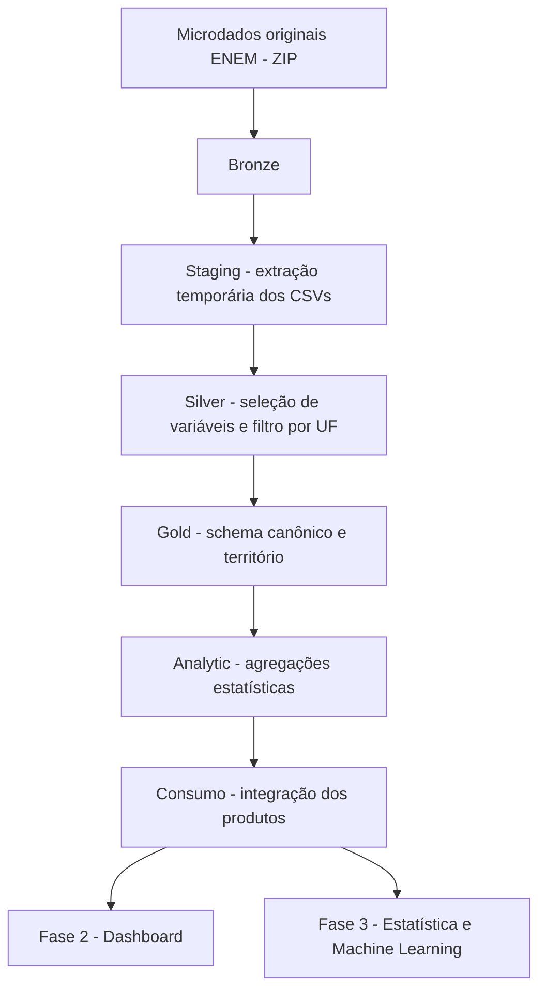

# Documentação técnica — Projeto ENEM

> **Status:** documentação técnica baseada na inspeção do código-fonte e dos notebooks incluídos no ZIP do projeto.  
> **Escopo do processamento:** microdados do ENEM de 1998 a 2025, com processamento segmentado por Unidade da Federação (UF).  
> **Arquitetura:** Bronze → Staging → Silver → Gold → Analytic → Consumo.

## 1. Contexto e objetivo

O projeto organiza e prepara os microdados históricos do Exame Nacional do Ensino Médio (ENEM), cobrindo o período de 1998 a 2025, para permitir análises estatísticas, temporais e espaciais em escala municipal.

A primeira fase do projeto é dedicada à engenharia e à organização dos dados. Seu propósito é transformar arquivos originais heterogêneos, com diferenças de estrutura entre os anos, em produtos padronizados e adequados para exploração analítica.

O processamento adota a arquitetura Medalhão, com cinco camadas persistentes:

1. **Bronze:** preservação e inventário das fontes originais.
2. **Silver:** seleção de variáveis, filtragem territorial e conversão para Parquet.
3. **Gold:** padronização do schema e da referência territorial, preservando o nível dos registros.
4. **Analytic:** produção de indicadores e estatísticas agregadas.
5. **Consumo:** integração e organização dos produtos analíticos para uso em aplicações e análises.

O Staging é uma área temporária de apoio à extração e ao processamento, não uma camada persistente da arquitetura Medalhão.

As fases seguintes do projeto são:
- **Fase 2 — Visualização:** desenvolvimento de dashboard, com tecnologia ainda a definir.
- **Fase 3 — Modelagem e investigação:** exploração de padrões, tendências e configurações espaciais por meio de métodos estatísticos e modelos de Machine Learning.

## 2. Escopo e unidade de processamento

- Período histórico configurado: **1998–2025**.
- Unidade geográfica de processamento: **UF**.
- Unidade territorial de referência da Gold: município, definida conforme o período histórico.
- Formato intermediário e de saída predominante: **Parquet**.
- Compressão dos arquivos Parquet: **ZSTD**.
- Ferramentas centrais: Python, DuckDB e Pandas.

A configuração central está em `src/enem_pipeline/config.py`. Ela define a UF padrão, o período, os diretórios e as configurações de leitura dos microdados.

A execução principal solicita interativamente a UF, o ano inicial e o ano final. A UF padrão definida em `config.py` (`PA`) é utilizada pelas funções quando nenhuma UF é informada; no orquestrador, a UF digitada é passada explicitamente às etapas.

## 3. Arquitetura e fluxo operacional



### 3.1 Orquestrador principal

O arquivo `executar_pipeline.py` é o orquestrador do processamento completo. Ele coordena as cinco etapas. Bronze e Silver usam funções de seus módulos; a construção da Gold (`executar_gold`) está implementada diretamente no orquestrador; Analytic e Consumo usam seus módulos próprios.

Fluxo implementado:

1. Solicita UF, ano inicial e ano final no terminal e valida os valores.
2. Inventaria os arquivos ZIP disponíveis em Bronze.
3. Verifica se existem fontes para todos os anos solicitados.
4. Limpa o conteúdo anterior de Staging.
5. Processa os anos sequencialmente:
   - extrai os CSVs principais;
   - valida os CSVs extraídos;
   - executa ou reutiliza o processamento Silver;
   - valida os Parquets;
   - limpa os CSVs temporários após o processamento validado.
6. Constrói a Gold e seu manifesto.
7. Constrói os oito produtos Analytic e seus metadados.
8. Constrói os três produtos Consumo e executa sua auditoria.

**Configuração de execução:** o orquestrador pergunta a UF e os anos no terminal. Os padrões de ano são 1998 e 2025. A UF padrão do módulo `config.py` é PA, mas não determina a UF da execução quando o usuário responde ao prompt.

O pipeline não baixa automaticamente os ZIPs. As fontes precisam estar previamente disponíveis em `data/bronze/`.

### 3.2 Execução segmentada por notebooks

Os notebooks permitem executar, inspecionar e auditar etapas separadamente.

| Notebook | Responsabilidade |
|---|---|
| `00_Download_data_ENEM.ipynb` | Obtenção das fontes originais |
| `01_Verificar_configuracao.ipynb` | Verificação de configuração, estrutura e leitura |
| `02_Execucao_silver_todos_anos_por_uf.ipynb` | Execução Silver por UF e por ano |
| `02a_Auditoria_silver.ipynb` | Auditoria da Silver |
| `03_Execucao_gold_municipio_ano.ipynb` | Construção da Gold |
| `03a_Auditoria_gold.ipynb` | Auditoria da Gold |
| `04_Execucao_analitico.ipynb` | Construção da Analytic |
| `05_Execucao_consumo.ipynb` | Construção da Consumo |
| `06_Analise_transversal.ipynb` | EDA transversal |
| `07_Analise_transversal_mapas.ipynb` | Representação cartográfica transversal |
| `08_Analise_longitudinal.ipynb` | Análise longitudinal periodizada |
| `09a_Analise_longitudinal_mapas.ipynb` | Análise longitudinal espacial |
| `09b_Analise_longitudinal_mapas_folium.ipynb` | Mapas interativos longitudinais |

Os notebooks de execução devem ser entendidos como interfaces de execução e inspeção das rotinas. As regras de transformação devem permanecer documentadas e, sempre que possível, centralizadas nos módulos Python.

## 4. Bronze — fontes originais

**Implementação:** `src/enem_pipeline/bronze.py`

### Objetivo

Manter os arquivos originais recebidos do INEP como fontes de referência, sem aplicar transformações analíticas sobre os dados originais.

### Entrada

Arquivos ZIP anuais, seguindo o padrão identificado no código:

`microdados_enem_AAAA.zip`

### Operações

- Inventário dos ZIPs disponíveis.
- Inspeção do conteúdo dos arquivos compactados.
- Identificação dos CSVs principais.
- Extração dos arquivos necessários para Staging.
- Validação dos CSVs extraídos.
- Inspeção do schema dos CSVs.

O processamento principal não extrai todo o período simultaneamente. A extração ocorre ano a ano para limitar o uso de armazenamento temporário.

### Saída

- ZIPs originais preservados em `data/bronze/`.
- CSVs extraídos temporariamente em `data/staging/ano=AAAA/`.

### Decisões

- Preservar a fonte original.
- Evitar alterações na Bronze.
- Extrair somente os CSVs necessários ao processamento.
- Limpar os CSVs temporários após sua conversão e validação na Silver.
- Interromper o processamento quando a extração ou validação apresentar falhas.

## 5. Staging — área temporária

**Implementação:** `executar_pipeline.py` e `src/enem_pipeline/silver.py`.

O Staging não é uma camada analítica persistente. Ele funciona como área de trabalho entre a extração dos arquivos ZIP e a construção dos Parquets Silver.

Estrutura:

```text
data/
└── staging/
    └── ano=AAAA/
        ├── arquivo_principal_1.csv
        └── arquivo_principal_2.csv
```

Os CSVs são removidos somente após o processamento e a validação do Parquet correspondente, quando a limpeza está habilitada. Em caso de falha, o arquivo de origem temporário é preservado para diagnóstico.

## 6. Silver — seleção, filtragem territorial e armazenamento

**Implementação:** `src/enem_pipeline/silver.py`, `catalogo.py` e `config.py`.

### Objetivo

Reduzir o volume dos microdados originais, mantendo apenas as variáveis selecionadas para o projeto e os registros correspondentes à UF processada.

### Entradas

- CSVs extraídos em Staging.
- Catálogo anual `data/metadata/dicionarios/variaveis_enem_por_ano.csv`.
- UF de processamento.

### 6.1 Catálogo de variáveis por ano

O arquivo `variaveis_enem_por_ano.csv` registra as variáveis selecionadas para cada ano entre 1998 e 2025.

A estrutura do catálogo é temporal: cada coluna representa um ano e cada célula preenchida contém uma variável selecionada para aquele ano.

A rotina `obter_variaveis_ano(ano)` recupera as variáveis não nulas e não vazias do ano solicitado.

O catálogo é a referência de seleção da Silver. Ele não deve ser interpretado como uma lista de todas as colunas existentes nos microdados originais.

### 6.2 Seleção de variáveis

A rotina `processar_csv_silver()` compara:

- variáveis definidas no catálogo para o ano;
- colunas efetivamente existentes no CSV.

A seleção corresponde à interseção entre essas duas listas. A variável territorial utilizada para filtrar a UF é adicionada à seleção caso ainda não esteja presente.

Assim:
- variáveis catalogadas, mas ausentes na fonte, não são inventadas;
- variáveis existentes na fonte, mas fora do catálogo, não são preservadas na Silver;
- a rotina retorna informações sobre as variáveis ausentes e as colunas da origem que ficaram fora do catálogo.

### 6.3 Filtro territorial

A filtragem é realizada pela sigla da UF na variável territorial correspondente ao período histórico:

| Anos | Variável de UF utilizada | Referência |
|---|---|---|
| 1998–2000 | `SG_UF_RESIDENCIA` | Residência |
| 2001–2007 | `SG_UF_ESC` | Escola |
| 2008–2025 | `SG_UF_PROVA` | Local de prova |

A seleção territorial da Silver determina quais registros entram no processamento da UF. A referência municipal canônica é construída posteriormente, na Gold.

### 6.4 Particularidade de 2024 e 2025

A partir de 2024, o código reconhece duas fontes principais:

- `PARTICIPANTES_AAAA.csv`
- `RESULTADOS_AAAA.csv`

Elas são convertidas em arquivos Silver separados:

- `participantes.parquet`
- `resultados.parquet`

Para 1998–2023, o arquivo de saída é `enem_AAAA.parquet`.

### 6.5 Tipos e codificação

O separador configurado é `;`. A codificação padrão é UTF-8, com exceções anuais definidas em `config.py` (Latin-1 para os anos ali listados).

A Silver utiliza DuckDB para ler os CSVs, aplicar seleção e filtro e gravar Parquet com compressão ZSTD.

### 6.6 Validação

A rotina `validar_parquet_silver()` verifica:
- existência e tamanho do arquivo;
- possibilidade de leitura e quantidade de registros maior que zero;
- presença da coluna territorial esperada;
- se todos os registros pertencem à UF solicitada;
- se `NU_ANO` corresponde ao ano esperado, quando a coluna existe.

A rotina `processar_ano_silver()` pode reutilizar um Parquet existente somente após validá-lo. Se a validação falhar, o arquivo é removido e reprocessado a partir do CSV. O CSV só é removido após validação bem-sucedida do Parquet.

### Saída e granularidade

```text
data/silver/uf=UF/ano=AAAA/
    enem_AAAA.parquet
```

ou, para 2024–2025:

```text
data/silver/uf=UF/ano=AAAA/
    participantes.parquet
    resultados.parquet
```

A Silver preserva o nível dos registros da fonte. Não realiza agregação municipal.

## 7. Gold — schema canônico e harmonização territorial

**Implementação:** construção em `executar_pipeline.py` (função `executar_gold`) e notebook `03_Execucao_gold_municipio_ano.ipynb`.

### Objetivo

Criar uma estrutura comum para os microdados históricos, mantendo o nível dos registros, mas padronizando nomes, tipos e referência territorial.

A Gold não é uma camada agregada. Cada linha continua representando um registro da fonte Silver.

### 7.1 Contrato canônico

O schema canônico possui 29 colunas:

| Grupo | Variáveis |
|---|---|
| Identificação e território (6) | `NU_ANO`, `TIPO_REFERENCIA_TERRITORIAL`, `SG_UF_TERRITORIO`, `CO_UF_TERRITORIO`, `CO_MUNICIPIO_TERRITORIO`, `NO_MUNICIPIO_TERRITORIO` |
| Participante (3) | `TP_SEXO`, `TP_FAIXA_ETARIA`, `ANO_CONCLUIU` |
| Presença (5) | `TP_PRESENCA`, `TP_PRESENCA_CN`, `TP_PRESENCA_CH`, `TP_PRESENCA_LC`, `TP_PRESENCA_MT` |
| Notas (6) | `NU_NOTA_CN`, `NU_NOTA_CH`, `NU_NOTA_LC`, `NU_NOTA_MT`, `NU_NOTA_OBJETIVA`, `NU_NOTA_REDACAO` |
| Redação (6) | `TP_STATUS_REDACAO`, `VL_PERC_COMP1`, `VL_PERC_COMP2`, `VL_PERC_COMP3`, `VL_PERC_COMP4`, `VL_PERC_COMP5` |
| Escola (3) | `CO_ESCOLA`, `TP_ESCOLA`, `TP_DEPENDENCIA_ADM_ESC` |

**Total: 29 colunas.**

### 7.2 Tipagem

O contrato define os tipos canônicos:
- `INTEGER`: ano, faixa etária, ano de conclusão e variáveis de presença.
- `VARCHAR`: identificadores territoriais, nomes, sexo, tipo de referência e status da redação.
- `DOUBLE`: notas e percentuais das competências de redação.

A tipagem é aplicada com CAST durante a construção da Gold.

### 7.3 Tratamento de variáveis ausentes

O schema deve ser idêntico em todas as fontes, mesmo quando determinada variável não existe em um ano ou em uma das bases de 2024–2025.

Quando a coluna não existe na origem, a rotina cria a coluna canônica com valor nulo e o tipo definido no contrato.

Isso garante compatibilidade estrutural sem atribuir valores artificiais aos registros.

### 7.4 Referência territorial histórica

A Gold consolida quatro campos territoriais em uma representação comum:

- `TIPO_REFERENCIA_TERRITORIAL`
- `SG_UF_TERRITORIO`
- `CO_UF_TERRITORIO`
- `CO_MUNICIPIO_TERRITORIO`
- `NO_MUNICIPIO_TERRITORIO`

A regra é:

| Período | Tipo | Código municipal de origem | Nome municipal de origem |
|---|---|---|---|
| 1998–2000 | `RESIDENCIA` | `CO_MUNICIPIO_RESIDENCIA` | `NO_MUNICIPIO_RESIDENCIA` |
| 2001–2007 | `ESC` | `CO_MUNICIPIO_ESC` | `NO_MUNICIPIO_ESC` |
| 2008–2025 | `PROVA` | `CO_MUNICIPIO_PROVA` | `NO_MUNICIPIO_PROVA` |

Os nomes e códigos de origem são mapeados para os campos canônicos. O tipo da referência territorial é registrado explicitamente para impedir que residência, escola e local de prova sejam interpretados como a mesma dimensão histórica.

**Importante:** a harmonização do nome do campo não torna os conceitos territoriais equivalentes. Comparações temporais precisam respeitar a mudança da referência.

### 7.5 Tratamento de 2024–2025

A Gold materializa separadamente as fontes `participantes` e `resultados`.

Não é realizado join individual entre elas. A compatibilidade é verificada no nível municipal, sem associar participantes de uma fonte a resultados de outra.

### 7.6 Saída

```text
data/gold/uf=UF/
    ano=AAAA/
        base=enem/
            dados.parquet
        base=participantes/
            dados.parquet
        base=resultados/
            dados.parquet
```

Para 1998–2023 existe uma fonte por ano (`enem`). Para 2024–2025 existem duas fontes por ano (`participantes` e `resultados`).

No intervalo completo, a expectativa é de 30 fontes: 26 fontes de 1998–2023 e quatro fontes de 2024–2025.

### 7.7 Manifesto Gold

O processamento gera `manifesto_gold_UF.csv`, com informações sobre ano, base, UF, referência territorial, arquivo de origem e arquivo Gold.

O manifesto é utilizado pela camada Analytic para localizar as fontes.

## 8. Analytic — produtos estatísticos municipais

**Implementação:** `src/enem_pipeline/analytic.py`.

### Objetivo

Transformar os registros individuais da Gold em produtos estatísticos agregados, sem modificar a Gold e sem produzir associação individual entre participantes e resultados.

### Unidade de agregação

A unidade básica é:

`ano × CO_MUNICIPIO_TERRITORIO`

Os produtos por grupo acrescentam dimensões como sexo, dependência administrativa da escola, faixa etária e disciplina.

### 8.1 Produtos produzidos

A rotina constrói oito produtos:

| Produto | Conteúdo | Granularidade |
|---|---|---|
| `demografia_municipal` | Quantidade de registros, contagens por sexo, percentuais por sexo e quantidade com faixa etária informada | Ano × município |
| `faixa_etaria_municipal` | Contagem de registros por faixa etária | Ano × município × faixa |
| `presenca_municipal` | Registros, presentes, ausentes, presença informada e percentuais | Ano × município |
| `desempenho_redacao_municipal` | Estatísticas da nota de redação | Ano × município |
| `desempenho_objetiva_municipal` | Estatísticas da nota objetiva | Ano × município |
| `desempenho_areas_municipal` | Estatísticas de CN, CH, LC e MT | Ano × município |
| `escola_municipal` | Contagens e percentuais por dependência administrativa | Ano × município |
| `desempenho_grupos_municipal` | Estatísticas de notas por grupo e disciplina | Ano × município × tipo de grupo × grupo × disciplina |

### 8.2 Estatísticas de desempenho

Para as variáveis de nota disponíveis, são calculadas:

- `n_validos`: quantidade de notas não nulas;
- `n_zeros`: quantidade de notas iguais a zero;
- `media`: média aritmética;
- `media_positivas`: média considerando apenas notas maiores que zero;
- `mediana`;
- `std`: desvio-padrão amostral;
- `q1`: primeiro quartil;
- `q3`: terceiro quartil.

A contagem de notas válidas é mantida explicitamente para que a média não seja interpretada sem informação sobre sua cobertura.

### 8.3 Periodização das disciplinas

A estrutura histórica de desempenho é diferente entre os períodos:

| Período | Indicadores de desempenho |
|---|---|
| 1998–2008 | `OBJETIVA` e `REDACAO` |
| 2009–2025 | `CN`, `CH`, `LC`, `MT` e `REDACAO` |

O produto `desempenho_objetiva_municipal` é produzido somente até 2008.

O produto `desempenho_areas_municipal` é produzido a partir de 2009.

A documentação e as análises devem preservar essa separação. Não se deve construir uma série contínua de desempenho entre as estruturas antiga e nova sem uma justificativa metodológica independente.

### 8.4 Grupos analíticos

O produto `desempenho_grupos_municipal` calcula estatísticas por:

- Sexo (`SEXO`);
- Dependência administrativa (`ESCOLA`);
- Faixa etária (`FAIXA_ETARIA`).

A disponibilidade histórica é respeitada:
- Sexo: anos anteriores a 2024, quando os códigos são identificáveis.
- Escola: a partir de 2001, quando a variável de dependência está disponível.
- Faixa etária: anos anteriores a 2024, quando disponível na fonte utilizada para esse produto.
- Disciplinas: seguem a periodização histórica.

Em 2024–2025, o produto de grupos utiliza a fonte `resultados`. Portanto, somente os grupos cujas variáveis estão disponíveis nessa fonte são produzidos.

### 8.5 Fontes utilizadas em 2024–2025

| Produto | Fonte |
|---|---|
| Demografia | `participantes` |
| Faixa etária | `participantes` |
| Presença | `resultados` |
| Desempenho em redação | `resultados` |
| Desempenho objetiva | Não produzido |
| Desempenho por áreas | `resultados` |
| Escola | `resultados` |
| Desempenho por grupos | `resultados` |

A separação evita uma junção individual não sustentada pelos dados disponíveis.

### 8.6 Saídas e metadados

```text
data/analytic/uf=UF/
    demografia_municipal.parquet
    faixa_etaria_municipal.parquet
    presenca_municipal.parquet
    desempenho_redacao_municipal.parquet
    desempenho_objetiva_municipal.parquet
    desempenho_areas_municipal.parquet
    escola_municipal.parquet
    desempenho_grupos_municipal.parquet
```

São gerados:
- `catalogo_analytic_UF.csv`
- `manifesto_analytic_UF.csv`

O catálogo descreve os produtos, suas granularidades, períodos e dimensões físicas. O manifesto fornece os caminhos utilizados pela camada Consumo.

## 9. Consumo — integração e produtos finais

**Implementação:** `src/enem_pipeline/consumo.py`.

### Objetivo

Organizar os produtos Analytic em estruturas adequadas para exploração, visualização e consumo por aplicações.

### 9.1 Painel municipal

O produto `painel_municipal` integra os indicadores cuja granularidade é ano × município.

A base demográfica define o universo de municípios e anos. Os demais produtos são associados por:

- `ano`;
- `CO_MUNICIPIO_TERRITORIO`.

As junções são do tipo left e validadas como um-para-um.

Antes da integração, o código:
- verifica a unicidade das chaves;
- harmoniza as dimensões territoriais;
- identifica colisões de nomes de métricas;
- renomeia métricas genéricas para evitar ambiguidades.

Exemplos de padronização:
- `media` de redação → `media_redacao`;
- `media` objetiva → `media_objetiva`;
- `n_registros` de presença → `n_registros_presenca`;
- `n_registros` escolares → `n_registros_escola`.

### 9.2 Produtos auxiliares

A Consumo preserva três produtos:

| Produto | Granularidade | Finalidade |
|---|---|---|
| `painel_municipal` | Ano × município | Painel integrado de demografia, presença, desempenho e perfil escolar |
| `faixa_etaria_municipal` | Ano × município × faixa etária | Distribuição etária |
| `desempenho_grupos_municipal` | Ano × município × tipo de grupo × grupo × disciplina | Desempenho segmentado |

Os dois últimos são preservados separadamente porque possuem granularidade diferente da tabela principal.

### 9.3 Auditorias

A camada verifica:
- existência dos arquivos listados no manifesto Analytic e presença dos seis produtos necessários ao painel, além dos dois produtos auxiliares;
- unicidade das chaves do painel, faixa etária e grupos;
- compatibilidade de nome municipal e tipo de referência territorial entre produtos que compartilham município-ano;
- ausência de colisões de nomes de métricas durante as junções;
- reconciliação das contagens por dependência administrativa, quando as colunas necessárias estão disponíveis. A auditoria também registra se cada produto final está vazio.

### 9.4 Saídas

```text
data/consumo/uf=UF/
    painel_municipal.parquet
    faixa_etaria_municipal.parquet
    desempenho_grupos_municipal.parquet
```

Metadados:
- `catalogo_consumo_UF.csv`
- `manifesto_consumo_UF.csv`
- `auditoria_consumo_UF.csv`

## 10. Variáveis e transformações por camada

Esta seção resume o ciclo de vida das variáveis.

| Camada | Variáveis e informações | Operação principal |
|---|---|---|
| Bronze | Colunas originais de cada CSV, conforme o ano | Preservação das fontes |
| Silver | Interseção entre catálogo anual e colunas da fonte, acrescida da coluna territorial necessária | Seleção e filtro por UF |
| Gold | 29 campos canônicos | Renomeação territorial, CAST e preenchimento estrutural com NULL quando a coluna não existe |
| Analytic | Dimensões municipais e métricas derivadas | Contagens, percentuais, médias, mediana, desvio-padrão e quartis |
| Consumo | Dimensões e métricas integradas, além dos produtos auxiliares | Junções um-para-um e organização por granularidade |

### 10.1 Variáveis preservadas na Gold

O contrato Gold preserva os seguintes conjuntos:

- **Identificação:** `NU_ANO`.
- **Território:** `TIPO_REFERENCIA_TERRITORIAL`, `SG_UF_TERRITORIO`, `CO_UF_TERRITORIO`, `CO_MUNICIPIO_TERRITORIO`, `NO_MUNICIPIO_TERRITORIO`.
- **Participante:** `TP_SEXO`, `TP_FAIXA_ETARIA`, `ANO_CONCLUIU`.
- **Presença:** `TP_PRESENCA`, `TP_PRESENCA_CN`, `TP_PRESENCA_CH`, `TP_PRESENCA_LC`, `TP_PRESENCA_MT`.
- **Notas:** `NU_NOTA_CN`, `NU_NOTA_CH`, `NU_NOTA_LC`, `NU_NOTA_MT`, `NU_NOTA_OBJETIVA`, `NU_NOTA_REDACAO`.
- **Redação:** `TP_STATUS_REDACAO`, `VL_PERC_COMP1` a `VL_PERC_COMP5`.
- **Escola:** `CO_ESCOLA`, `TP_ESCOLA`, `TP_DEPENDENCIA_ADM_ESC`.

### 10.2 Variáveis derivadas na Analytic

As variáveis derivadas não são colunas individuais da fonte. São indicadores agregados:

- Contagens: `n_participantes`, `n_masculino`, `n_feminino`, `n_presentes`, `n_ausentes`, `n_validos` e outras contagens específicas.
- Percentuais: `pct_masculino`, `pct_feminino`, `pct_presenca`, `pct_ausencia` e percentuais por dependência administrativa.
- Estatísticas: `media`, `media_positivas`, `mediana`, `std`, `q1` e `q3`.
- Dimensões analíticas: `tipo_grupo`, `grupo` e `disciplina`.

### 10.3 Variáveis derivadas na Consumo

A Consumo integra métricas da Analytic e padroniza nomes para evitar colisões. Não deve ser descrita como uma nova extração de variáveis originais: é uma reorganização de indicadores já calculados.

## 11. Regras metodológicas transversais

### 11.1 Não confundir ausência com zero

Valores nulos indicam ausência de informação ou indisponibilidade. Valores iguais a zero são valores observados e recebem contagem própria nas estatísticas de desempenho.

### 11.2 Respeitar a cobertura histórica

A presença de uma coluna no schema canônico não significa que ela esteja preenchida em todos os anos. O schema padronizado permite compatibilidade estrutural; a disponibilidade efetiva depende da fonte histórica.

### 11.3 Não associar individualmente participantes e resultados em 2024–2025

A integração ocorre em nível municipal. Nenhuma correspondência individual deve ser inferida entre as duas bases.

### 11.4 Respeitar a referência territorial

Residência, escola e local de prova são conceitos distintos. A variável `TIPO_REFERENCIA_TERRITORIAL` deve acompanhar as análises e ser considerada ao comparar períodos.

### 11.5 Respeitar as estruturas de avaliação

O período 1998–2008 utiliza uma estrutura de desempenho diferente daquela vigente a partir de 2009. As análises transversais e longitudinais do projeto devem manter os períodos separados quando a comparabilidade não estiver demonstrada.

## 12. EDA e análises exploratórias

Os notebooks 06 a 09b consomem principalmente os produtos da camada Consumo.

### 12.1 Análise transversal

`06_Analise_transversal.ipynb`

Realiza uma fotografia analítica de um ano selecionado:
- panorama municipal;
- distribuição de participantes;
- estatísticas de desempenho;
- rankings municipais;
- relações entre disciplinas;
- diferenças por dependência administrativa;
- diferenças por sexo;
- diferenças por faixa etária;
- perfil municipal de participação e desempenho.

A interpretação das disciplinas segue a periodização histórica.

### 12.2 Mapas transversais

`07_Analise_transversal_mapas.ipynb`

Produz mapas municipais de um único ano. A junção com a malha geográfica é realizada pelo código municipal.

O notebook apresenta a distribuição espacial da participação e dos indicadores de desempenho disponíveis para o ano selecionado.

### 12.3 Análise longitudinal

`08_Analise_longitudinal.ipynb`

Investiga a evolução temporal:
- tendências estaduais;
- desempenho por rede escolar;
- desempenho por sexo;
- desempenho por faixa etária;
- estabilidade da posição municipal;
- rankings e recorrência nos extremos;
- diferença entre redes pública e privada.

As séries são periodizadas conforme as estruturas de avaliação.

### 12.4 Mapas longitudinais

`09a_Analise_longitudinal_mapas.ipynb` e `09b_Analise_longitudinal_mapas_folium.ipynb`

Investigam a evolução espacial:
- cobertura municipal nos anos de referência;
- mapas de anos selecionados;
- variação entre extremos de período;
- tendências municipais por regressão linear;
- visualização interativa com Folium na versão correspondente.

Os mapas devem distinguir falta de informação de desempenho baixo e preservar a separação entre os períodos históricos.

## 13. Estrutura de diretórios

Estrutura lógica esperada:

```text
projeto_enem/
├── executar_pipeline.py
├── README.md
├── DOCUMENTACAO.md
├── notebook/
│   ├── 00_Download_data_ENEM.ipynb
│   ├── 01_Verificar_configuracao.ipynb
│   ├── 02_Execucao_silver_todos_anos_por_uf.ipynb
│   ├── 02a_Auditoria_silver.ipynb
│   ├── 03_Execucao_gold_municipio_ano.ipynb
│   ├── 03a_Auditoria_gold.ipynb
│   ├── 04_Execucao_analitico.ipynb
│   ├── 05_Execucao_consumo.ipynb
│   ├── 06_Analise_transversal.ipynb
│   ├── 07_Analise_transversal_mapas.ipynb
│   ├── 08_Analise_longitudinal.ipynb
│   └── 09*_Analise_longitudinal_mapas*.ipynb
├── src/
│   ├── enem_pipeline/
│   │   ├── config.py
│   │   ├── estrutura.py
│   │   ├── bronze.py
│   │   ├── catalogo.py
│   │   ├── silver.py
│   │   ├── analytic.py
│   │   └── consumo.py
│   └── utils/
│       ├── eda.py
│       └── features_names.py
└── data/
    ├── bronze/
    ├── staging/
    ├── silver/
    ├── gold/
    ├── analytic/
    ├── consumo/
    └── metadata/
        └── dicionarios/
            └── variaveis_enem_por_ano.csv
```

A árvore acima representa a organização lógica. Arquivos de dados processados, ambientes virtuais, caches e arquivos de configuração local podem não estar presentes no repositório ou no pacote compartilhado.

## 14. Como executar

Na raiz do projeto, com o ambiente Python configurado e as dependências instaladas:

```bash
python executar_pipeline.py
```

Antes de executar:
1. Verifique se os ZIPs necessários estão em `data/bronze/`.
2. Confirme a UF configurada no bloco principal do orquestrador.
3. Confirme o intervalo de anos.
4. Verifique o catálogo anual de variáveis.
5. Confirme os diretórios e as permissões de gravação.

O pipeline interrompe a execução quando encontra fontes ausentes, falhas de validação ou inconsistências. As camadas já gravadas permanecem disponíveis para diagnóstico.

Para execução segmentada, utilize os notebooks de execução correspondentes, respeitando a ordem Bronze/Silver, Gold, Analytic e Consumo.

## 15. Auditoria e rastreabilidade

Os manifestos e catálogos são parte da arquitetura, não apenas arquivos auxiliares.

| Artefato | Finalidade |
|---|---|
| `manifesto_gold_UF.csv` | Rastrear fontes Silver e arquivos Gold |
| `catalogo_analytic_UF.csv` | Descrever produtos Analytic |
| `manifesto_analytic_UF.csv` | Localizar os produtos Analytic |
| `catalogo_consumo_UF.csv` | Descrever produtos Consumo |
| `manifesto_consumo_UF.csv` | Localizar os produtos Consumo |
| `auditoria_consumo_UF.csv` | Registrar verificações da Consumo |

As auditorias Silver e Gold também são realizadas nos notebooks próprios.

## 16. Limitações e pontos de atenção

1. A padronização de schema não elimina diferenças conceituais entre os anos.
2. A referência territorial muda ao longo do período.
3. A comparabilidade das notas exige periodização.
4. Em 2024–2025, as bases de participantes e resultados não são associadas individualmente.
5. A disponibilidade de variáveis varia por ano e por fonte.
6. O número de participantes calculado pela Analytic corresponde à contagem de linhas da fonte Gold, sem deduplicação automática.
7. A média e as demais estatísticas de nota dependem dos valores disponíveis e devem ser interpretadas junto das contagens válidas.
8. A documentação estática descreve as regras do código. A confirmação de cobertura, quantidade de registros e preenchimento efetivo depende dos manifestos e Parquets gerados em cada execução.

## 17. Roadmap do projeto

### Fase 1 — Engenharia e organização dos dados

- [x] Organização em arquitetura Medalhão.
- [x] Processamento Bronze e Silver.
- [x] Padronização Gold.
- [x] Construção Analytic.
- [x] Construção Consumo.
- [x] Notebooks de execução e análise exploratória.
- [ ] Consolidação da documentação técnica e operacional.
- [ ] Revisão final da rastreabilidade entre variáveis, produtos e arquivos gerados.

### Fase 2 — Dashboard

Definir tecnologia e arquitetura de visualização. O dashboard deverá consumir prioritariamente os produtos da camada Consumo, sem reproduzir transformações já realizadas no pipeline.

### Fase 3 — Modelagem e investigação

Investigar padrões e tendências, incluindo:
- configuração espacial do desempenho municipal;
- evolução temporal de indicadores;
- relações entre participação, perfil dos participantes e desempenho;
- agrupamentos de municípios;
- tendências e possíveis padrões espaciais;
- modelos estatísticos e de Machine Learning.

A seleção de variáveis e a definição das unidades de análise deverão respeitar a cobertura histórica e as limitações de comparabilidade descritas nesta documentação.

---

## 18. Arquivos de referência do código

- `executar_pipeline.py`: orquestração completa.
- `src/enem_pipeline/config.py`: configuração central.
- `src/enem_pipeline/bronze.py`: inventário, extração e validação das fontes.
- `src/enem_pipeline/catalogo.py`: leitura do catálogo anual.
- `src/enem_pipeline/silver.py`: seleção, filtro territorial e geração da Silver.
- `src/enem_pipeline/analytic.py`: construção dos oito produtos analíticos.
- `src/enem_pipeline/consumo.py`: integração, produtos finais e auditoria.
- `notebook/03_Execucao_gold_municipio_ano.ipynb`: contrato canônico e execução segmentada da Gold.


## 19. Detalhamento dos produtos Analytic conforme a implementação

Todos os produtos utilizam como dimensões territoriais comuns `ano`, `CO_MUNICIPIO_TERRITORIO`, `NO_MUNICIPIO_TERRITORIO` e `TIPO_REFERENCIA_TERRITORIAL`. A coluna `base_origem` identifica a origem Gold utilizada em produtos nos quais é adicionada pelo código.

| Produto | Métricas/variáveis produzidas |
|---|---|
| `demografia_municipal` | `n_participantes`, `n_masculino`, `n_feminino`, `n_faixa_etaria_informada`, `pct_masculino`, `pct_feminino`, `base_origem` |
| `faixa_etaria_municipal` | `TP_FAIXA_ETARIA` (VARCHAR), `n_participantes`, `base_origem` |
| `presenca_municipal` | `n_registros`, `n_presentes`, `n_ausentes`, `n_presenca_informada`, `pct_presenca`, `pct_ausencia`, `base_origem` |
| `desempenho_redacao_municipal` | `n_validos`, `n_zeros`, `media`, `media_positivas`, `mediana`, `std`, `q1`, `q3`, `n_avaliados_redacao` |
| `desempenho_objetiva_municipal` | `n_validos`, `n_zeros`, `media`, `media_positivas`, `mediana`, `std`, `q1`, `q3`, `n_avaliados_objetiva` |
| `desempenho_areas_municipal` | Para cada área disponível (CN, CH, LC, MT): `n_validos_*`, `n_zeros_*`, `media_*`, `media_positivas_*`, `mediana_*`, `std_*`, `q1_*`, `q3_*` e `n_avaliados_*` |
| `escola_municipal` | `n_registros`, contagens `n_escola_federal`, `n_escola_estadual`, `n_escola_municipal`, `n_escola_privada`, `n_escola_nao_informada`, `n_dependencia_informada` e percentuais `pct_escola_*` |
| `desempenho_grupos_municipal` | `tipo_grupo`, `grupo`, `disciplina`, `n_validos`, `n_zeros`, `media`, `media_positivas`, `mediana`, `std`, `q1`, `q3`, `base_origem` |

### 19.1 Regras exatas dos indicadores

- `n_participantes` é `COUNT(*)` dos registros da fonte Gold; não há deduplicação individual.
- As contagens de sexo são calculadas somente quando o domínio observado permite reconhecer os dois códigos esperados (`0/1`, `1/2` ou `M/F`). Caso contrário, `n_masculino` e `n_feminino` ficam nulos. Os percentuais usam `n_participantes` como denominador.
- Faixa etária conta registros por código de faixa não nulo; o código é convertido para texto no produto.
- Presença considera `TP_PRESENCA = 1` como presente e `TP_PRESENCA = 0` como ausente. Os percentuais usam `n_presenca_informada` como denominador; outros códigos não entram nessas duas contagens.
- Estatísticas de nota são calculadas sobre valores numéricos não nulos. `n_zeros` conta valores iguais a zero. `media_positivas` considera apenas notas maiores que zero. `std` é desvio-padrão amostral e `q1`/`q3` são quantis contínuos de 25% e 75%.
- Escola: os códigos 1, 2, 3 e 4 são classificados como Federal, Estadual, Municipal e Privada. Os percentuais `pct_escola_*` usam `n_registros` como denominador. Antes de 2001, as contagens das categorias são nulas, mas o produto municipal é produzido.
- Desempenho por grupos: sexo é produzido antes de 2024 quando os códigos são reconhecidos; dependência administrativa é produzida a partir de 2001 quando a coluna existe; faixa etária é produzida antes de 2024 quando a coluna existe. Cada grupo é cruzado com as disciplinas disponíveis naquele ano.

### 19.2 Seleção das fontes por produto

| Produto | 1998–2023 | 2024–2025 |
|---|---|---|
| Demografia e faixa etária | `enem` | `participantes` |
| Presença, redação, escola e grupos | `enem` | `resultados` |
| Nota objetiva | `enem`, somente até 2008 | Não produzido |
| Áreas CN, CH, LC e MT | `enem`, a partir de 2009 | `resultados` |

A rotina `_sources_for_product()` existe no módulo, mas a execução efetiva dos produtos é controlada pelos blocos de seleção de fonte dentro de `executar_camada_analitica()`.

## 20. Detalhamento da Consumo conforme a implementação

O `painel_municipal` usa `demografia_municipal` como universo-base de município-ano. Sobre essa base, o código integra por junções `left`, com validação `one_to_one`, os produtos:

- `presenca_municipal`;
- `desempenho_redacao_municipal`;
- `desempenho_objetiva_municipal`;
- `desempenho_areas_municipal`;
- `escola_municipal`.

A chave de junção é `ano` + `CO_MUNICIPIO_TERRITORIO`. Antes da junção, a rotina verifica unicidade e compatibilidade de `NO_MUNICIPIO_TERRITORIO` e `TIPO_REFERENCIA_TERRITORIAL`. A dimensão de nome e tipo não é usada como chave adicional.

O mapa de renomeação evita colisões: métricas genéricas de presença, redação, objetiva e escola recebem sufixos específicos. Quando disponíveis, `n_validos_redacao` e `n_validos_objetiva` também são expostos como `n_avaliados_redacao` e `n_avaliados_objetiva`.

`faixa_etaria_municipal` e `desempenho_grupos_municipal` são copiados como produtos auxiliares, sem junção ao painel, porque possuem granularidade mais detalhada.

## 21. Observação de correção no orquestrador recebido

O arquivo `executar_pipeline(1).py` recebido contém, no bloco final, duas chamadas a `main()` em sequência:

```python
if __name__ == "__main__":
    main()
    raise SystemExit(main())
```

Isso faz com que a execução interativa do pipeline seja iniciada duas vezes quando o arquivo é executado diretamente. A forma esperada é manter apenas uma chamada, por exemplo:

```python
if __name__ == "__main__":
    raise SystemExit(main())
```

Esta observação é um apontamento de revisão; não foi alterado o código-fonte do usuário.
